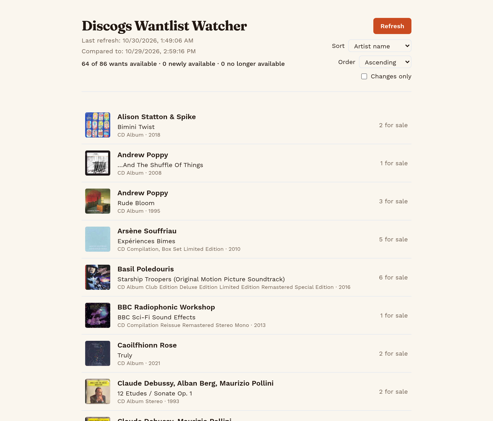

# Discogs Wantlist Watcher

A single-page web app that shows which items in a Discogs wantlist currently have copies for sale — and which items became available or went out of stock since the last check.

**Live app**: https://discogs-wantlist-watcher.lovable.app



## What it does

- **Available items only**: the main list shows only wants with copies currently for sale.
- **Change tracking**: items that just became available are pinned at the top with a "Newly available" badge; items that dropped to zero copies are listed in a collapsible "No longer available" section.
- **Changes only** toggle to filter down to just what changed since the last refresh.
- **Sorting**: by Artist name (default), Album title, Release year, or Copies for sale, each ascending or descending. Newly available items stay pinned regardless of sort.
- **Refresh progress**: refreshing re-checks the full wantlist at ~1 item per second (Discogs' rate limit), with a spinning-record progress panel showing live counts.

No login is needed to view the page — the wantlist status is intentionally public. Read-only: the app never edits the wantlist.

## Documentation

- [PRD — Discogs Wantlist Watcher](docs/discogs-wantlist-watcher-prd.md)

## How it works

- A backend (Lovable Cloud) stores the current status of each want (`wantlist_status`) and an audit of each refresh run (`refresh_runs`), which also drives the progress panel.
- On refresh, the app paginates the wantlist, then checks the marketplace listing count for each item one at a time, pacing requests at ~1/second. Requests go through Lovable's linked Discogs connection relay; a full refresh can take a few minutes.
- A shared refresh lock prevents overlapping checks. Discogs rate limits trigger automatic cooldowns and bounded retries, with a countdown on the page; failed checks preserve the previous results.
- Discogs connection credentials are kept private and are never exposed on the page.

## Build with Lovable

Continue developing this project in the [Lovable editor](https://lovable.dev/projects/b8c23c07-6b8e-44df-823f-b0e120b30c55).

- **Ship faster**: describe what you want to build and Lovable handles the code.
- **Stay in sync**: every change made in Lovable is committed straight to this repository.
- **Full ownership**: this code is yours. Push to `main` on GitHub and your changes sync back into Lovable, ready for your next prompt.

## Development

Prefer working locally? You need Node.js and npm — [install with nvm](https://github.com/nvm-sh/nvm#installing-and-updating).

```sh
git clone <this-repository-url>
cd <repository-name>
npm i
npm run dev
```
